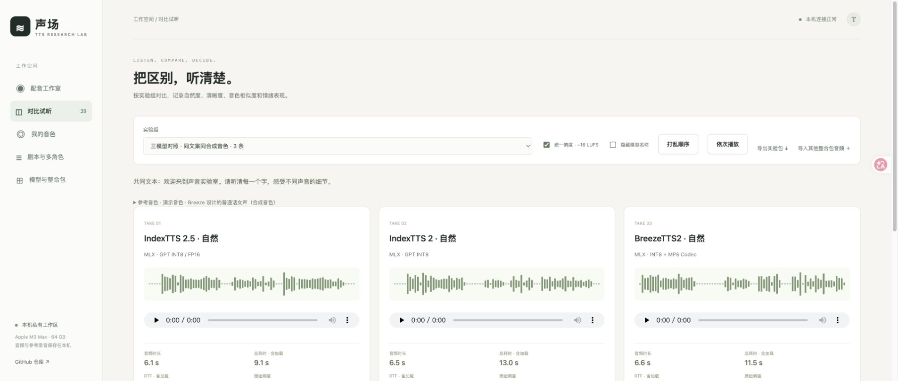

# 本机验证记录

核对时间：2026-11-05T14:52:35+08:00。机器：Apple M3 Max · 64 GB，macOS 26.6。

三套引擎已真实生成可解码、非静音的 WAV，权重 SHA-256 检查通过。使用社区 MLX 量化路线；合成演示参考，不代表真人克隆质量验收。

## 直接进入试听

- [三模型共同文本](http://127.0.0.1:8765/compare?job=6cd0f479c0f2405b)
- [五种语气 × 三模型，共 15 条](http://127.0.0.1:8765/compare?job=3d7449039631486e)
- [三模型英文](http://127.0.0.1:8765/compare?job=3abdf3aeef9143ba)
- [Index 2.5 日语](http://127.0.0.1:8765/compare?job=70ca0187c18d4c18)
- [多段剧本、拼接 WAV 与 SRT](http://127.0.0.1:8765/compare?job=7d6da98aafb24959)
- [173 字长文原始对照，含异常](http://127.0.0.1:8765/compare?job=61d1f5eb7d3447ae)
- [Index 2.5 长文 40 token 分段复测](http://127.0.0.1:8765/compare?job=7a215be2928d43f0)

## 一次短句对照的实际耗时

| 模型 | 音频时长 | 模型进程耗时 | 冷启动 RTF |
| --- | ---: | ---: | ---: |
| IndexTTS 2.5 | 6.11 s | 9.06 s | 1.484 |
| IndexTTS 2 | 6.47 s | 13.02 s | 2.013 |
| BreezeTTS2 | 6.56 s | 11.48 s | 1.749 |

这是一次本机演示的原始记录，包含进程启动、加载与参考编码，排队和 FFmpeg 后处理不计入；不是重复多轮的性能基准，也不能用来推导音质排名。

## 自动转写与异常保留

本地 Whisper base 检查了 32 条研究样本：22 条经繁简、标点等归一化后与请求一致，10 条有差异。小模型会将部分近音词识别错误，因此这些差异需要结合原文实际试听，不视为已确认的 TTS 错读。

IndexTTS 2.5 原 100 token 分段长文的自动转写严重异常，重复了与原文不符的内容；原输出和日志保留。仅将分段文本上限改为 40 token 后，同样的 173 字文本恢复为接近原文的转写，诊断 CER 从 0.9545 降到 0.0649。这个数字含识别器误差，不作为音质评分。工作台默认已使用 40 token 分段。

## 工作流验证

- 10 项自动测试通过：输入边界、同源限制、失败状态、音频处理与字幕、参考录音、情绪对照、评分持久化、导出、外部导入。
- 权重与依赖锁核对通过；Index MLX 崩溃修复见 [运行时记录](运行时修复记录.md)。
- 浏览器验证三条音频连续播放直到结束，期间后台生成没有中断播放；切换盲听保留未保存的评分草稿。
- 桌面与 430px 宽度布局验证通过，窄屏内容宽度未超出视口。
- 真正通过 HTTP 下载核对了 ZIP 内三条原始 WAV 和 scores.csv，以及剧本 WAV 和 SRT。
- 未填写或编造真人主观评分，音频和参考录音保存在本机，未上传 GitHub。

完整参数、样本哈希和转写见 [verification.json](verification.json)。

